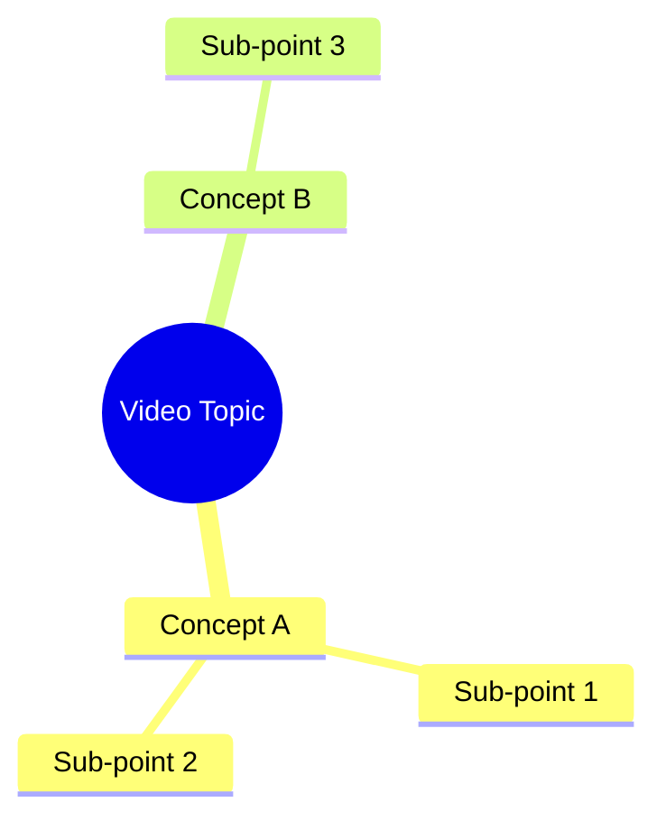
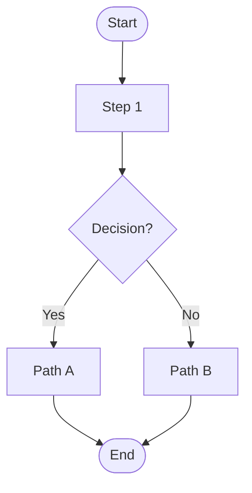

# 🎬 YouTube Video Analyzer

An AI-powered agent that analyzes YouTube videos and produces structured outputs:
- **Step-by-Step Procedures** — actionable numbered instructions
- **Mind Maps** — Mermaid diagrams showing key concepts and relationships
- **Flowcharts** — Mermaid process diagrams showing workflows

## Architecture

```
YouTube URL → Transcript Extraction → LLM Analysis → Structured Output
                 (youtube-transcript-api)    (Gemini)       ↓
                                                  ┌─────────┼──────────┐
                                                  │         │          │
                                              Steps.md  MindMap.mmd  Flowchart.mmd
                                                  │         │          │
                                                  └─────────┼──────────┘
                                                            ↓
                                                       Report.md
```

## Quick Start

### 1. Install dependencies

```bash
pip install -r requirements.txt
```

### 2. Configure API key

```bash
cp .env.example .env
# Edit .env and add your Gemini API key
# Get one free at: https://aistudio.google.com/apikey
```

### 3. Run the analyzer

```bash
# Analyze a video (generates all outputs)
python main.py https://www.youtube.com/watch?v=VIDEO_ID

# Or use just the video ID
python main.py VIDEO_ID

# Include raw transcript in the report
python main.py VIDEO_ID --include-transcript

# Generate only specific outputs
python main.py VIDEO_ID --steps-only
python main.py VIDEO_ID --mindmap-only
python main.py VIDEO_ID --flowchart-only
```

## Project Structure

```
YouTube_Video_Analyzer/
├── main.py                      # CLI entry point
├── requirements.txt             # Python dependencies
├── .env.example                 # API key template
├── src/
│   ├── __init__.py
│   ├── transcript.py            # YouTube transcript extraction
│   ├── analyzer.py              # Gemini LLM integration
│   ├── utils.py                 # File saving & report generation
│   └── generators/
│       ├── __init__.py
│       ├── steps.py             # Step-by-step procedure generator
│       ├── mindmap.py           # Mermaid mind map generator
│       └── flowchart.py         # Mermaid flowchart generator
└── output/                      # Generated analysis reports
    └── <video_id>/
        ├── steps.md
        ├── mindmap.mmd
        ├── flowchart.mmd
        └── report.md
```

## Output Examples

### Step-by-Step Procedure
A numbered list with prerequisites, detailed instructions, and warnings.

### Mind Map (Mermaid)


### Flowchart (Mermaid)


## How It Works

1. **Transcript Extraction** — Uses `youtube-transcript-api` to fetch subtitles (no API key needed)
2. **Chunking** — Long transcripts are split into ~3000-char chunks at sentence boundaries
3. **LLM Analysis** — Each chunk is sent to Gemini with task-specific prompts
4. **Merging** — For multi-chunk videos, partial results are merged into coherent outputs
5. **Report Generation** — All outputs are combined into a single Markdown report

## Tech Stack

| Component | Tool |
|---|---|
| Transcript Extraction | `youtube-transcript-api` |
| LLM | Google Gemini (`gemini-2.0-flash`) |
| CLI Interface | `rich` |
| Configuration | `python-dotenv` |
| Diagrams | Mermaid syntax |

## License

MIT
